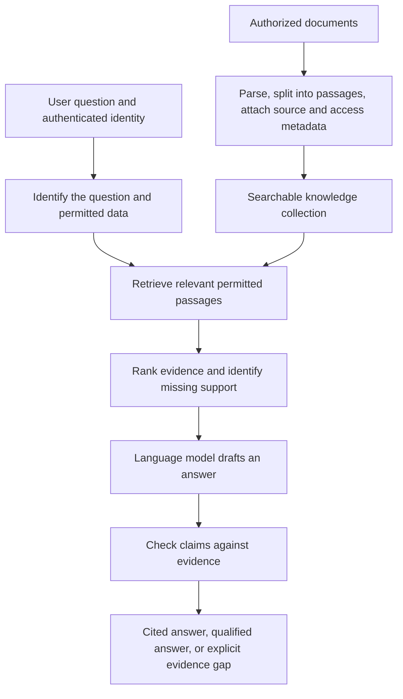

# NX-Shield RAG

**How to build a technical assistant that finds relevant documents, respects access rules, and explains what its evidence does—and does not—support.**

NX-Shield RAG is an independent design notebook for a Nutanix-focused question-answering system. It is written for engineers who understand infrastructure and APIs but may be new to AI. The implementation and recovery source are private; **this repository is documentation, not an installable application or a public source-code release**.

> This is not an official Nutanix product, Nutanix Validated Design, support commitment, or compliance certification. Product names identify the technologies discussed; they do not imply endorsement. Use official product documentation for supported configurations and operational procedures.

## RAG in one minute

**Retrieval-augmented generation (RAG)** means finding relevant information before asking a language model to write an answer. Think of it as an open-book examination: the assistant first selects useful reference passages, then answers from those passages.

For example, when someone asks, “What should I check before an infrastructure upgrade?”:

1. The application identifies the product, version, and questions it must answer.
2. It searches documents the user is allowed to access.
3. It selects relevant passages, favoring authoritative and version-appropriate sources.
4. The language model drafts an answer using those passages.
5. The application checks the draft against the evidence and either delivers it, narrows it, or reports a gap.

This is **not the same as training a model on the documents**. Updating a RAG knowledge collection usually changes the retrieval data, not the model's learned parameters. RAG can improve grounding; it does not guarantee correctness or eliminate hallucinations.

## The system at a glance

This is a conceptual flow, not a deployment status report. Access checks must remain effective throughout retrieval, ranking, model calls, fallback paths, and delivery—not just at the front door.

## Why not just use a vector database?

A vector database helps find text with similar meaning. It does not, by itself, decide whether a document is authoritative, current, permitted for the user, or sufficient to support a particular claim.

This design adds:

- **Hybrid search:** combine meaning-based search with keyword and exact-identifier lookup. A similar topic is not necessarily the right KB article or product version.
- **Source and access policy:** separate “relevant” from “allowed,” and “official” from “appropriate to this question.”
- **An evidence ledger:** record the questions to answer, supporting passages, and missing evidence before drafting.
- **Deterministic tools:** use calculators for arithmetic rather than asking the model to guess a result.
- **Optional graph context:** use relationships between entities as search hints, not proof of a claim.
- **Answer checks and safe operations:** evaluate quality, disclose limitations, and test changes before enabling them for users.

Each control has limits. A keyword-coverage check is not proof that a passage supports a claim; an automated verifier is not a substitute for expert review of high-impact advice.

## Start here

### Understand the basics

1. [RAG concepts and glossary](docs/getting-started/rag-basics.md) — embeddings, chunks, reranking, and other terms in plain language.
2. [Architecture](docs/design/architecture.md) — component responsibilities and boundaries.
3. [Example question and evidence obligations](examples/query-obligations.md) — what a grounded answer needs to establish.

### Design and build

- [Retrieval pipeline](docs/design/retrieval-pipeline.md) and [evidence ledger](docs/design/evidence-ledger.md).
- [Metadata and corpus](docs/design/metadata-and-corpus.md), [schema](docs/design/lancedb-schema.md), and [ingestion](docs/build/ingestion-and-corpus.md).
- [Graph context](docs/design/graph-context.md) and [enterprise design trade-offs](docs/design/enterprise-rag-strengths.md).
- [Security and access](docs/design/security-and-access.md) and [governance boundaries](docs/design/ai-governance-alignment.md).

### Evaluate and operate

- [Evaluation strategy](docs/evaluate/evaluation-strategy.md) — test relevance, correctness, access isolation, and failure handling separately.
- [Runtime and MCP](docs/operate/runtime-and-mcp.md) and [operations playbook](docs/operate/operations-playbook.md).
- [Rebuild guide](docs/build/rebuild-from-private-source.md) and [private source map](docs/build/private-source-map.md) — for authorized maintainers; the public repository alone cannot rebuild the system.
- [Design evolution](docs/evaluate/rag-improvements-release-note.md) and [milestone lineage](docs/evaluate/milestone-lineage.md) — historical context, not live readiness evidence.

## Reading the detailed diagrams

[Portable query-flow source](diagrams/rag-system.mmd) provides a text-based architecture view. The [advanced query-path illustration](diagrams/sample-query-path-vcf-aos.png) shows additional controls and rollout options.

The advanced illustration uses compact implementation terminology. Read the glossary first. Labels such as “approved,” “fail closed,” “supported claims only,” and “public-safe” describe intended controls or publication boundaries—not independently verified compliance or a guarantee that every generated answer is correct. Rollout-gated components must be validated for the actual deployment before use.

## Scope and publication rules

- This repository explains our RAG architecture and engineering: ingestion, retrieval, evidence controls, evaluation, and operations. Nutanix solution technical information belongs in the RAG knowledge collection, not in this public repository. Do not publish product feature guides, solution deployment details, or solution-specific integration designs here.
- No customer data, internal enablement content, licensed analyst extracts, source-document collections, credentials, private operational reports, or live environment details belong here.
- A right to read a document is not automatically a right to redistribute it or send it to a model provider.
- Do not use this notebook to infer product licensing, hardware compatibility, official support, or an approved deployment. Those require the applicable authoritative sources and organizational review.
- No live accuracy percentage, latency promise, availability target, or current rollout status is asserted here. Such claims need reproducible, revision-bound evidence from the environment in question.

See [publication and contribution guidance](CONTRIBUTING.md) before proposing changes.
