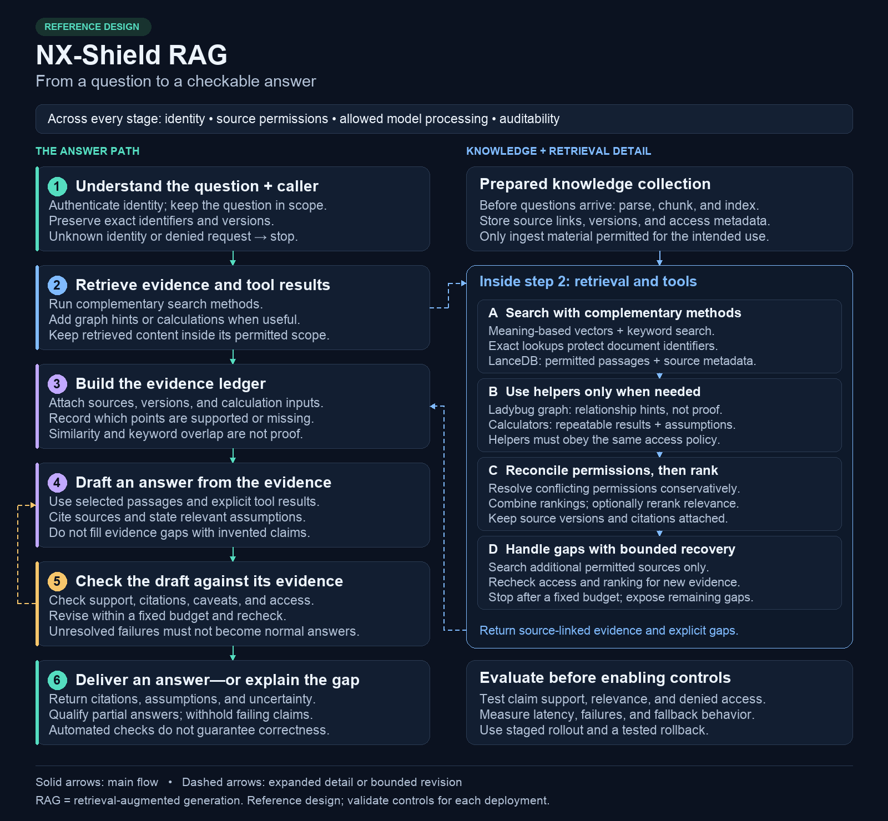

# Diagram assets

[Project home](../README.md) · [Documentation index](../docs/README.md)

## Main query-path diagram

[](rag-query-path.png)

- [PNG](rag-query-path.png) — the main README visual; 1600 × 1480 pixels.
- [Editable SVG](rag-query-path.svg) — vector version for reading, editing, or export.
- [Python renderer](render_query_path.py) — generates both formats from the same layout and text.
- [Simplified Mermaid flow](rag-system.mmd) — a compact conceptual view, not a pixel-identical source of the main diagram.

The numbered column is the main answer path. The right panel expands retrieval and tools. Solid arrows show progression; dashed arrows show the detail handoff/return or a bounded revision back to drafting. Verification follows drafting and must be repeated after revision.

This is a reference design. It does not establish live feature status, validated model integrations, production readiness, or guaranteed answer correctness. It contains RAG engineering concepts, not Nutanix solution details.

## Reproduce the image

Requirements: Python 3, Pillow, and installed TrueType fonts. The defaults are `Arial.ttf` and `Arial Bold.ttf`; provide alternatives through `--font` and `--bold-font` if those names are unavailable.

From the repository root, render to a separate preview directory:

```sh
python3 diagrams/render_query_path.py --out /tmp/rag-diagram-preview
```

For different installed fonts:

```sh
python3 diagrams/render_query_path.py \
  --font /path/to/regular.ttf \
  --bold-font /path/to/bold.ttf \
  --out /tmp/rag-diagram-preview
```

The renderer writes `rag-query-path.png`, `rag-query-path.svg`, and a local `render-report.json` containing dimensions and checksums. The report is a rendering artifact, not runtime evidence. Text-width assertions reject overflow; inspect the rendered image as well. Different font files or rendering-library versions can change pixels. The SVG uses an Arial/Helvetica/sans-serif font stack, so a viewer's installed fonts can also affect display.

Before replacing published files, review the preview for readable labels, correct arrow direction, overlap, and public-content boundaries. Keep the PNG, SVG, and renderer consistent; do not publish preview reports or environment details.

## Existing image-link compatibility

[`sample-query-path-vcf-aos.png`](sample-query-path-vcf-aos.png) is retained only to preserve previously shared image URLs. It contains the **same PNG bytes** as `rag-query-path.png`; it is not a product-comparison or solution diagram. Use the neutral canonical filename for new links, and update the compatibility copy whenever the main PNG changes.
