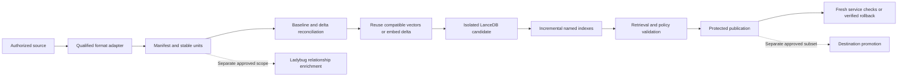

# Ingestion and Corpus Build

[Documentation index](../README.md) · [Project home](../../README.md)

> **Scope:** Independent project design guidance, not a Nutanix-approved implementation. This page does not establish deployed behavior, measured effectiveness, or vendor support. The public repository does not include a runnable service.

## Reading this page

**Ingestion** converts authorized source documents into a searchable **corpus** (collection). A **chunk** is a passage stored as one retrieval unit. An **embedding** represents its text numerically; **FTS** means full-text search. **Provenance** connects a chunk to its origin. A **canary** is a representative regression test; **promotion** switches serving to a validated candidate. LanceDB and Ladybug are the reference vector/text and graph components, not bundled services.

The ingestion pipeline should produce a searchable, policy-aware corpus — not just chunks.

## Target output

Each ingested unit should have:

- clean text,
- source identity,
- document and section identity,
- product/version metadata,
- source family and authority,
- access/confidentiality class,
- stable hashes,
- embedding vector,
- lexical-search text,
- optional graph/entity extraction output,
- governance metadata such as approved use scope, owner, review status, and retention/removal expectations where applicable.

## Recommended stages

## Incremental update contract

Routine ingestion is **add or reconcile content**, not **rebuild the corpus**. Use one maintained downstream workflow with explicitly qualified source adapters:

1. Bind an authorized source manifest to the baseline snapshot, extraction/chunking settings, embedding model and dimensions, intended audience, and source hashes.
2. Classify unchanged, new, changed, conflicting, and rejected units. Stable identity alone is insufficient: compare content and policy as well.
3. Reuse compatible existing vectors for unchanged content. Journal acquisition intent and validated results so a retry does not blindly re-embed completed units.
4. Write the admitted delta into an isolated candidate while preserving unrelated baseline fields and vector bytes.
5. Extend existing named indexes and verify complete index coverage. Routine updates must not silently retrain or replace the vector-index base.
6. Validate actual retrieval and policy, then perform protected publication with verified recovery. An unchanged-input rerun should have zero document embedding acquisitions and zero row writes.

Embedding reuse requires matching model, dimensions, preprocessing, and content identity—not merely equal vector length. Policy changes must still pass new authorization checks. A checkpoint is reusable only while its source and baseline bindings remain valid.

## Capability and qualification boundaries

Declare each adapter's supported input shape and acceptance evidence before a batch begins. A structured single-article JSON adapter is not a multi-chunk PDF adapter. A document-specific PDF workflow can reuse indexing and publication components without establishing general PDF support.

Keep these claims separate:

- **Component reuse:** existing writer, index, or publication primitives were used.
- **Format qualification:** the adapter preserves source structure and policy for its declared format.
- **Repeatability:** a second distinct batch, unchanged rerun, mixed new/unchanged inputs, and interrupted-run recovery pass through unchanged code.
- **Live availability:** fresh service queries retrieve the admitted source for the intended identity and deny excluded identities.
- **Graph coverage and distribution:** separately approved relationships and destination subsets were validated and published.

An implementation owner must supply the release-specific capability record. This public handbook does not distribute those adapters or certify arbitrary-format support.

## Efficiency evidence

Record per-phase durations for extraction, embedding, staging, indexing, validation, and publication. Separate first-time adapter development from routine batch execution. Count document embedding calls, retries, and reuse separately from query-validation embeddings. Report rows preserved/written, staging bytes copied, index operations, additional disk usage, and recovery attempts.

A small new-row fraction is not a measured latency or cost improvement. Incremental indexing can still require substantial staging copies and whole-corpus validation. State whether staging used a full copy or a qualified copy-on-write snapshot; do not infer either from the word “incremental.” Compare like-for-like baselines before publishing speedup figures.

## Source normalization

Normalize sources before embedding:

- preserve headings and section hierarchy,
- keep URLs/document IDs,
- remove navigation boilerplate,
- record version/product context,
- avoid mixing multiple documents into one anonymous text blob.

Before ingestion, also record whether the source is approved for the intended RAG use. Treat licensing, data classification, personal/customer/partner data, source-code or telemetry content, and third-party analyst material as approval gates, not as after-the-fact cleanup.

## Layered authoritative-source capture

Authenticated documentation portals often expose more than one useful representation of the same authority. A reproducible capture should preserve the available layers separately rather than flattening them into one anonymous scrape:

1. inventory/search metadata used to select the current document;
2. canonical document identity and publication metadata;
3. structured generated-document content, including recursive section hierarchy;
4. canonical PDF or other published artifact when available;
5. page/section text extracted with explicit quality checks;
6. provenance manifest and checksums tying every derived chunk back to its source layer.

Require complete identities, non-empty leaf sections, bounded chunks, and deterministic source hashes before embedding. A title match or incidental paragraph already present in the corpus is not proof that the complete current authority has been ingested.

## Chunking strategy

Use chunking that respects source structure. For technical docs, headings and sections often matter more than arbitrary token windows.

Good chunks should be:

- small enough for precise retrieval,
- large enough to contain procedure context,
- linked to parent document/section,
- stable across rebuilds where possible.

## Indexes

A mature RAG store usually needs:

- vector index for semantic recall,
- FTS index for exact terms,
- scalar indexes for source family/access/product/version,
- stable identity fields for deduplication.

The reference LanceDB contract uses one embedding vector column, one lexical `search_text` column, and scalar indexes over identity, source, access, version, and lineage fields. The public-safe schema is documented in [LanceDB schema](../design/lancedb-schema.md).

Benchmark before adding indexes. Index churn without measured need can complicate rebuilds.

## Controlled corpus promotion

Treat a corpus update as a candidate promotion, not as an in-place write to the active store:

1. freeze the source and provenance bundle;
2. build typed rows in an isolated stage;
3. reconcile exact document, section, URL, hash, and body identities against the active corpus;
4. build a candidate by preserving qualified existing indexes and indexing only the incoming delta where practical;
5. validate new-document retrieval, exact-ID behavior, source/access policy, ranking preservation, and any graph linkage explicitly included in the batch;
6. if destination promotion is authorized, compare logical state over each destination-approved subset; validate graph state only within the declared graph scope;
7. freeze a promotion binding to the exact candidate and rollback artifacts;
8. quiesce only the affected services, promote atomically, restart, and run fresh direct and profile-level canaries;
9. roll back automatically if any required gate fails.

Rebuilding every index can change approximate-nearest-neighbor ordering even when row content is unchanged. Prefer an incremental/index-preserving candidate when it passes both new-content retrieval and frozen preservation canaries. Keep historical rows unless an independently reviewed deletion policy explicitly authorizes physical removal.
