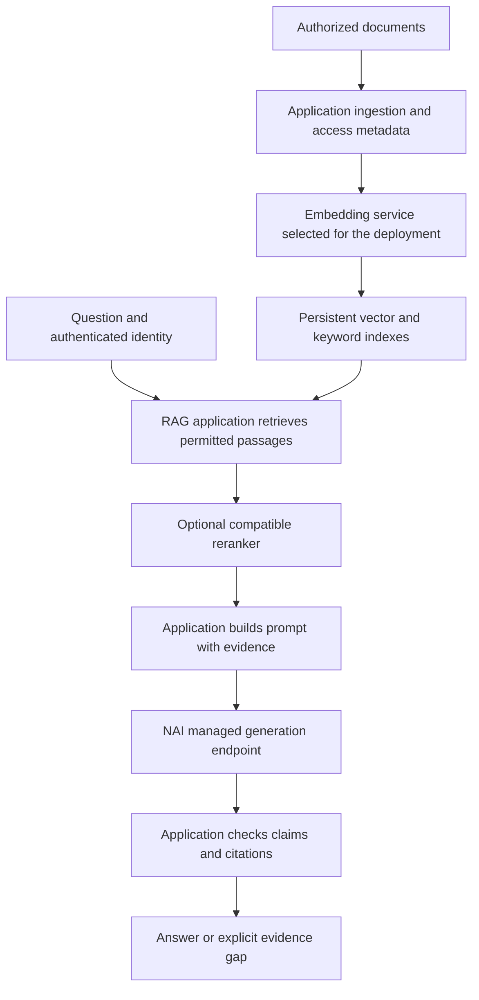

# Where Nutanix Enterprise AI fits in a RAG deployment

[Home](../../README.md) · Prerequisite: [RAG basics](rag-basics.md)

**NAI provides managed model inference and governance capabilities; the RAG application still needs a retrieval and data-management design.** Nutanix's public NIVA architecture article illustrates this separation: NAI handles model-serving operations while the application team focuses on retrieval, agent workflows, and the user experience.[1][2]

This page explains a potential integration pattern. It does **not** claim NX-Shield has been deployed on, certified for, or validated with NAI. NX-Shield is an independent project, not NIVA, and this notebook is not NIVA's implementation.

## Start with the responsibilities

### The model platform

Nutanix describes NAI as a platform for managing inference, models, and agents. Its public product page describes endpoint management, role-based access, auditing, and support for Kubernetes environments including Nutanix Kubernetes Platform (NKP).[1]

The NIVA engineering article specifically describes standardized model deployment, lifecycle management, health monitoring, and authenticated inference endpoints. That is the operational work NAI can take off the application team's plate.[2]

These descriptions are not a compatibility matrix. Select model, API, accelerator, Kubernetes, and storage combinations using the documentation for the release you intend to deploy.

### The surrounding RAG application

For the conceptual architecture in this notebook, the application and data services are responsible for:

- Source connectors, parsing, chunking, and document refresh.
- A persistent search collection with source/version metadata and document-level permissions.
- Retrieval, optional reranking, prompt construction, and citations.
- Identity propagation and permission enforcement at every data boundary.
- Quality evaluation, operational monitoring, retention, backup, and recovery.

This is a **recommended responsibility split**, not an exhaustive statement of everything included or excluded in an NAI release. Do not assume a model-platform feature replaces an application control without testing the complete path.

## A conceptual deployment

The embedding service converts text to vectors. A reranker improves the ordering of retrieved passages. **Their placement and endpoint compatibility must be established for the selected deployment**; this diagram does not assert that any arbitrary embedding or reranker model runs on NAI.

In particular, the application's vector database is a separate architectural responsibility. Choosing NAI for inference does not establish that a particular database integration, backup method, or permission model is supported.

## What about MCP and agents?

MCP is a protocol for giving an AI application access to tools. A RAG search service can be exposed as a tool; a model-generation API and a retrieval-tool API are different interfaces.

Nutanix's NAI 2.8 announcement identifies **MCP server management in Nutanix Agent Gateway as generally available**, including local/remote MCP server access and permissions for users or API keys.[3]

That offers a possible governance layer for an application consuming a retrieval tool. It does **not** prove that NX-Shield's transport, authentication, identity propagation, or tool contracts have been tested with that gateway. Before using this pattern, test:

1. Tool discovery and the supported transport/authentication combination.
2. The identity received by the retrieval service—do not silently turn all callers into one privileged identity.
3. Denied-user and denied-document cases through the actual end-to-end path.
4. Timeouts, cancellations, unavailable tools, and bounded retries.
5. Audit records without credential or restricted-content leakage.

**Version boundary:** the NAI 2.8 announcement still labels header-based token-budget rate limiting, multi-node/multi-GPU inference, and KV-cache offloading as Tech Preview. It says Tech Preview features should not be used in production. Do not treat the whole release as having one uniform feature status.[3]

## Demonstration versus production acceptance

A document-Q&A demonstration answers, “Can the components produce a useful response?” Production acceptance must also answer, “Will the system behave correctly for different users, stale or missing evidence, failures, updates, and recovery?”

For NAI Labs / Talk To My Data setup and limits, consult the official guide for your installed release. This public notebook does not reproduce access-restricted guide content or treat a demonstration workflow as production qualification.

Suggested acceptance sequence for this project's integration pattern:

1. **Define the data boundary:** approved sources, users, retention, and allowed model-processing locations.
2. **Verify model APIs:** request schema, authentication, model names, context limits, and response handling.
3. **Build persistent retrieval:** ingestion, metadata, access filters, and refresh behavior.
4. **Evaluate grounded answers:** representative questions, exact-version claims, contradictions, citations, and evidence gaps.
5. **Test failures and operations:** denied access, malformed responses, service outages, backup/restore, and rollback.
6. **Obtain deployment approval:** use the organization's security, legal, data-owner, and change-control processes.

This is a design checklist, not a Nutanix installation runbook, license determination, or support certification.

## Evidence scope

Reviewed on 2026-09-08. Sources below are openly accessible Nutanix product and engineering/announcement pages. They support the statements attributed to them, but do not establish NX-Shield compatibility, customer-specific sizing, licensing, performance, or formal approval. Release documentation remains the authority for implementation details. No internal enablement material or licensed analyst excerpts are reproduced here.

## Sources

[1] https://www.nutanix.com/products/nutanix-enterprise-ai
[2] https://www.nutanix.com/blog/building-a-conversational-assistant-on-nutanix-enterprise-ai
[3] https://www.nutanix.com/blog/charting-the-path-to-governed-agentic-ai-with-nutanix-enterprise-ai-2-8
